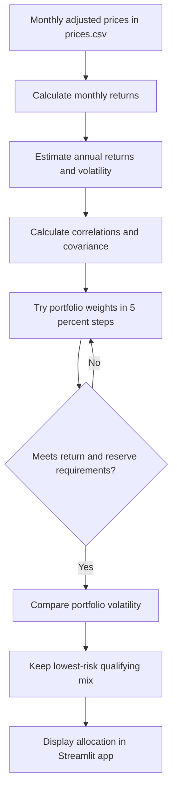

# Lab 15 — Portfolio Stability Decision

## Portfolio Universe
- BIL — SPDR Bloomberg 1–3 Month T-Bill ETF (cash reserve)
- IEF — iShares 7–10 Year Treasury Bond ETF (government bonds)
- LQD — iShares iBoxx Investment Grade Corporate Bond ETF (fixed income)
- VT — Vanguard Total World Stock ETF (global equities)

**Data source:** Yahoo Finance via yfinance  
**Downloaded:** October 22, 2026  
**Period:** September 2021–September 2026  
**Data:** 61 monthly adjusted closing prices per ETF, stored in prices.csv.

## Mandate Used for Testing
- Minimum expected return: 6.5%
- Minimum reserve-eligible allocation: 3%
- Reserve-eligible ETFs: BIL and IEF

These are Meridian's training thresholds; my Project 2 mandate must be confirmed separately.

## Historical Data Results

| Metric | All 5 Years | Last 36 Months |
|---|---|---|
| Expected return | 6.50% | 6.50% |
| Volatility | 10.12% | 7.89% |
| BIL | 30% | 30% |
| IEF | 0% | 0% |
| LQD | 5% | 5% |
| VT | 65% | 65% |

**Largest allocation change between periods:** 0 percentage points.

The portfolio allocation stayed the same, but estimated volatility decreased when using the last 36 months.

## Stability and Decision

**Decision: Pilot, not adopt.** The allocation remained stable across the two historical windows, but estimated risk changed from 10.12% to 7.89%. I would want to verify the return estimates, data quality, and mandate requirements before adopting it.

## Partner Stress Test
Not yet completed. Record the asset estimate changed, the new portfolio weights, and a two-sentence explanation after testing.

## Engine Flowchart

